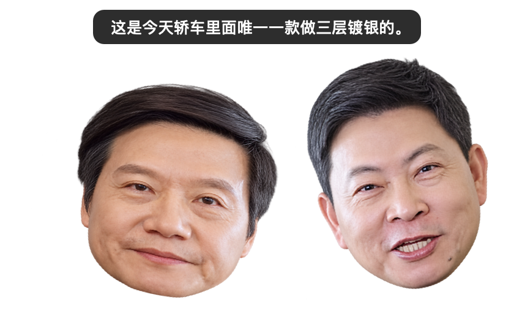

# 雷余双桌宠

两个分别运行的 macOS 桌宠：**雷军桌宠.app** 和 **余承东桌宠.app**。每个桌宠使用用户提供的透明人物图片，能够独立点击、拖动、调整大小和退出。

原始录音是一段两位 CEO 的隔空对话。项目把录音按**说话人**和**对话段**拆成 17 段：雷军 9 段、余承东 8 段；其中四组连续的余承东句子和两组连续的雷军句子（“最大马力…”“零百加速…”；“但我相信…”“后来者…”）各合并为一段，段内顺序保持原音频。合并段内的字幕会跟着声音逐句切换。

这 17 段里配成了 **8 组一问一答**：两位靠近时点任一人像，雷军先说一段，余承东马上接对应的那一段；只有正在说话的一方弹动、显示字幕。没靠近时点谁就只播谁自己的单段。把两个人物拖近，两颗头会向对方倾斜。



## 安装与启动

支持 Apple Silicon Mac，系统需要 macOS 14 或更新版本。

1. 从 [Releases](https://github.com/yuhanfu513-ops/leiyu-desktop-pets/releases/latest) 下载 `LeiYu-Desktop-Pets-v2.0.zip`，解压。
2. 将其中的两个 `.app` 都拖到“应用程序”。
3. 分别双击两个桌宠启动；也可以先打开其中一个，再通过右键菜单打开另一位。

启动后，两个人物默认分开放在屏幕底部左侧，菜单栏分别显示“雷军”和“余承东”。应用没有 Dock 图标。

## 更新与排错

替换 `/Applications` 里的 `.app` 前，先退出两位桌宠再替换。macOS 的旧进程会继续使用启动时读到的台词索引；如果在运行中替换，旧菜单可能指向已经改名或删除的音频，表现为“这句无法播放”或音频和字幕对不上。退出两位再重新打开就能恢复。新版菜单里是 **17 段合并后的台词**（雷军 9 段、余承东 8 段），不是 25 条单句；点其中一段会播放整段，字幕按句子跟着音频切换。

## 怎么互动

| 操作 | 效果 |
| --- | --- |
| 没靠近时单击任一人物 | 该人物随机说一段**自己声音**的台词，同时上下弹动并显示字幕；另一位不弹、不出声 |
| 两位靠近时单击任一人物 | 按配对表由**雷军先说**一段，**余承东后说**对应的一段；只有正在说话的一方弹动、显示字幕 |
| 连续单击同一位 | 重新随机抽一段/一对；正在播的片段会被新内容接替 |
| 一段没说完时点另一位 | 没靠近时切换音频；靠近时重新开始一组问答，仍然雷军先说 |
| 拖动任一人物 | 独立移动，退出后记住位置 |
| 将两个人物拖近 | 两颗头同时向对方倾斜，**不会自动播放声音** |
| 拉开距离 | 两颗头慢慢回正 |
| 播完一段 | 字幕随音频逐句切换，播完约 0.4 秒后消失 |
| 右键 → 随机说一段 | 只播当前人物的一段（不配对） |
| 右键 → 两人对话一句 | 靠近时手动开始一组问答；没靠近会提示先拖近 |
| 右键 → 挑一段 | 只播指定的一段（不配对） |
| 右键 → 停止播放 | 立即停止两位的播放、取消正在进行的问答并清除字幕 |
| 右键 → 音量 | 调整两位共用的播放音量 |
| 右键 → 歪头距离 | 调整“靠近”的触发距离（贴近 8、靠近 32、较远 80 屏幕点） |
| 右键 → 人物大小 | 只调整当前人物的大小 |
| 右键 → 退出当前桌宠 | 只退出这一位 |

右键菜单和菜单栏菜单均提供“打开另一位桌宠”“靠近时互相歪头”的开关及“恢复默认位置”。“靠近时互相歪头”只控制歪头动画，不影响问答：只要在“歪头距离”以内，点人物就会触发一组问答。系统开启“减少动态效果”时，弹动和歪头动画会直接到位，播放、字幕和问答顺序不变。

## 素材与台词

- `Assets/lei.png`：雷军的人物图片。
- `Assets/yu.png`：余承东的人物图片。
- `Assets/encounter.m4a`：从 `ScreenRecording_10-25-2026 21-47-11_1.MP4` 提取的完整原始音轨，约 51.36 秒。
- `Tools/lines.json`：17 段台词的时间边界、说话人和字幕文本；四组连续的余承东句子（“漂移…”“什么2秒…”“不能把所有…”“发布了…”）和两组连续的雷军句子（“最大马力…”“零百加速…”；“但我相信…”“后来者…”）各合并成一段，段内保留原来的句子顺序，合并后的清单顺序仍与原音频一致。合并段用 `parts` 记录每句话的绝对时间。
- `Assets/Clips/*.mp3`：由 `Tools/build-clips.py` 从原始音轨切出的逐段 MP3，每段只包含一位说话人的声音。
- `Assets/clips.json`：应用读取的台词清单（编号、角色、字幕、文件名、时长）；合并段还带 `lines`，记录每句话相对音频的起止时间和文本，应用据此逐句切换字幕。
- `Assets/pairs.json`：8 组问答的配对表（组号、雷军片段 ID、余承东片段 ID），靠近时的“雷军先说、余承东后说”就是按它执行。

台词的时间边界来自说话人分离（sherpa-onnx 的 pyannote 分割 + campplus 声纹嵌入）和视频画面里烧录的字幕；字幕按画面字幕和上下文做了整理。最后一句保留了原片的“这他妈的绝对是捣乱”，并按声纹归到雷军；如果不想保留，删除 `Tools/lines.json` 最后一行后重新生成即可。想改字幕，编辑 `Tools/lines.json` 后重新生成：

```sh
Tools/venv/bin/python Tools/build-clips.py
```

图片保留原始透明背景和比例。每个角色只加载 `clips.json` 中属于自己声音的片段，因此不会出现“没说话的那位也在弹”的情况。合并段不会一次把整段字幕全显示出来：应用根据 `lines` 里的相对时间，在音频播到每句话时切换字幕，字幕和声音保持一致。

### 8 组问答

| 组 | 雷军先说 | 余承东后说 |
| --- | --- | --- |
| 1 | 小米SU7玩漂移，特别过瘾。 | 漂移就是带来交通事故，知道吧？ 我说那是一个最愚蠢的行为。 |
| 2 | 最大马力1548匹。 零百加速1.98秒。 | 什么2秒加速性能，还是3秒加速性能？ 这都没有意义的，知道吧？ 真的是，重要的是安全性。 |
| 3 | 我说我们一定要做最好的手机支架。 | 强大的心脏，无需手机支架。 |
| 4 | 这是今天轿车里面唯一一款做三层镀银的。 | 不能把所有的都搞成这个镀银。 因为它会使信号严重减弱。 |
| 5 | 但我相信，这个世界终究不会是强者恒强。 后来者总有机会。 | 发布了全新一代的F9， 让他们永远追不上。 |
| 6 | 总有机会。 | 追不上。 |
| 7 | 总有机会。 | 追不上。 |
| 8 | 总有机会。 | 追不上。 |

雷军最后一句“这他妈的绝对是捣乱。”没有对应的余承东台词，所以不参与靠近问答；需要时可以右键“挑一段”单独播放。

## 构建

需要 Xcode Command Line Tools。应用本身不依赖第三方库：

```sh
./build.sh
open build/雷军桌宠.app
open build/余承东桌宠.app
```

构建脚本会生成两个独立应用、复制 `clips.json` 和 `Clips/` 到各自的 `Contents/Resources`，并进行本地签名。图标已包含在 `Assets` 内；如果替换图片，可通过 `Tools/make-icons.swift` 重新生成图标。

如果修改了 `Tools/lines.json`，先运行 `Tools/build-clips.py` 再构建。仓库不包含 `Tools/venv`（虚拟环境太大），需要时自行创建：

```sh
python3 -m venv Tools/venv
Tools/venv/bin/pip install av numpy
Tools/venv/bin/python Tools/build-clips.py
```

如果重新跑说话人分离/转写，再安装 `sherpa-onnx`、`faster-whisper`（见 `Tools/diarize.py`、`Tools/transcribe-lines.py`）。

重新生成安装包：

```sh
./Tools/package.sh
```

脚本会重新构建、跑两位的自检、把两个 app 和 `使用说明.txt` 放进 `Work/Release/雷余双桌宠/`，并重新生成根目录的 `雷余双桌宠-安装包.zip`。

## 验证

```sh
build/雷军桌宠.app/Contents/MacOS/LeiYuPet --self-test
build/余承东桌宠.app/Contents/MacOS/LeiYuPet --self-test
python3 Tools/integration-test.py
```

自检会检查透明无边框窗口、只加载自己声音的台词、每段都有字幕、字幕时间有序、MP3 时长与清单一致、8 组问答配对完整、随机不重复，以及歪头方向。

集成检查会启动两个静音、隐藏的测试实例，使用临时状态目录，检查：

- 两个应用只加载各自的 9/8 段台词，音频文件齐全；8 组问答配对完整；
- 点雷军时只有雷军弹动、只有雷军显示字幕；
- 点余承东时只有余承东弹动、只有余承东显示字幕；
- 合并段的字幕会随音频从第一句切到第二、第三句（余承东三句段和雷军两句段都测）；
- 靠近时从余承东发起问答，仍然是雷军先说、余承东后说，两人的字幕都对；
- 靠近时从雷军发起问答，也按同样顺序执行；
- 靠近时直接点人物会触发一组问答；
- 一段没播完时点另一位，会接管唯一的音频通道；
- 拖近只让两颗头向对方倾斜，不会自动播放；
- 说话时仍然保持歪头，没说话的那位不弹；
- 停止按钮会同时停止两位、取消正在进行的问答并清除字幕；
- 退出其中一位会停掉它自己的声音，另一位的头回正。

`--preview <png>` 可以把当前人物、字幕和歪头效果渲染成一张图，便于检查排版；加 `--preview-line N` 可以看合并段的第 N 条字幕，加 `--preview-speaking` 可以看到说话弹动时的压缩姿态。

## 本地设置与联动

两个应用只使用本机文件和本机进程通知通信，无需联网或额外系统权限。位置和大小按应用分别保存；音量、歪头距离和开关保存在 `~/Library/Application Support/LeiYuDesktopPets/settings.json`。同目录的角色状态文件用于判断彼此的位置、运行状态和当前角度；停止运行或过期的状态不会触发歪头。

默认歪头距离为图片显示区域边缘间距 32 屏幕点，分离到至少 56 屏幕点后才回正，避免轻微拖动导致头部来回摆动。同一时间只有一位能播放，靠 `audio.lock` 文件锁和 `playback.json` 播放声明协调。

## 许可

代码与文档采用根目录的 MIT `LICENSE`。窗口与拖动交互参考 SunPet，保留其 `LICENSE-SunPet`。人物图片和音频素材不属于代码许可范围。
